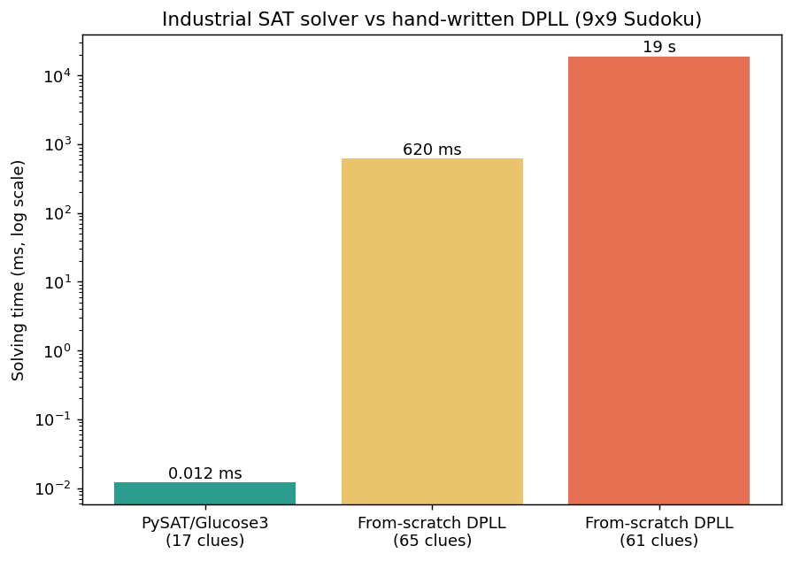

# Sudoku Solving with SAT: From a Hand-Written DPLL to an Industrial Solver

A personal research project (TIPE, done during my CPGE MPI, prior to engineering school) exploring how Sudoku, including a diagonal variant, can be solved by encoding it as a boolean satisfiability (SAT) problem, comparing a hand-written DPLL algorithm against PySAT's Glucose3, a real industrial CDCL solver.



## The idea

A Sudoku grid can be encoded as a CNF (conjunctive normal form) boolean formula: one variable per (row, column, digit) possibility, and one clause per Sudoku rule (each cell holds exactly one digit, each digit appears once per row/column/block). Solving the Sudoku is then equivalent to finding an assignment that satisfies every clause, which is exactly what a SAT solver does.

This project implements that encoding for two variants (classic Sudoku and a diagonal variant where both main diagonals must also contain every digit once), and solves it two ways:

- **From scratch**: a textbook DPLL algorithm (`dpll_from_scratch_4x4.py`, `dpll_from_scratch_4x4_diagonal.py`, `dpll_from_scratch_9x9.py`), to understand and demonstrate how a SAT solver actually works.
- **With a real solver**: PySAT's binding to Glucose3, an industrial CDCL (Conflict-Driven Clause Learning) solver (`sat_solver_classic.py`, `sat_solver_diagonal.py`).

The full report (`docs/report.pdf`, in French) and slides (`docs/slides.pdf`, in French) cover the theory (CNF encoding, DPLL, unit propagation, an introduction to CDCL) and the complete set of results.

### A genuine finding: naive DPLL does not scale

The hand-written DPLL has none of the heuristics a real solver relies on (watched literals, clause learning, smart variable ordering), so it is only practical on 4x4 grids or very easy 9x9 grids. Measured on this machine:

| Solver | Grid | Clues | Time |
|---|---|---|---|
| From-scratch DPLL | 9x9 | 65 (easy) | ~0.6 s |
| From-scratch DPLL | 9x9 | 61 (easy) | ~19 s |
| From-scratch DPLL | 9x9 | 55 | did not finish in 90 s |
| PySAT / Glucose3 | 9x9 | 17 (minimum possible) | ~0.01 s |

Glucose3 solves a 9x9 grid with the theoretical minimum of 17 clues in about 10 milliseconds, several orders of magnitude faster than the from-scratch solver on a much easier grid. This gap is the practical justification, discussed in the report, for using a real SAT solver rather than a textbook implementation once the grid gets large.

## Repository structure

```
sudoku-sat-solver/
├── src/
│   ├── grid_generator.py                  # Shared grid generation/printing utilities
│   ├── sat_solver_classic.py              # Classic Sudoku via PySAT/Glucose3
│   ├── sat_solver_diagonal.py             # Diagonal variant via PySAT/Glucose3
│   ├── dpll_from_scratch_4x4.py           # Hand-written DPLL, classic 4x4
│   ├── dpll_from_scratch_4x4_diagonal.py  # Hand-written DPLL, diagonal 4x4
│   ├── dpll_from_scratch_9x9.py           # Hand-written DPLL + unit propagation, 9x9
│   └── dimacs_export.py                   # Export a puzzle's CNF encoding to DIMACS format
├── results/                               # Captured console output from each script
├── assets/                                # Visuals used in this README
└── docs/
    ├── report.pdf                          # Full written report (French)
    └── slides.pdf                          # Presentation slides, with annexes (French)
```

## Installation

```bash
git clone https://github.com/<your-username>/sudoku-sat-solver.git
cd sudoku-sat-solver
pip install -r requirements.txt
```

## Usage

Each script is self-contained and run from the `src/` folder:

```bash
cd src
python sat_solver_classic.py       # classic Sudoku, PySAT/Glucose3
python sat_solver_diagonal.py      # diagonal variant, PySAT/Glucose3
python dpll_from_scratch_4x4.py    # hand-written DPLL, 4x4
python dpll_from_scratch_9x9.py    # hand-written DPLL, 9x9 (see the performance note above)
python dimacs_export.py            # export a puzzle to sudoku.cnf
```

## Notes on this cleanup

This project started as an exploratory research project with many draft versions of each script. For this repository, I kept the most complete, correct version of each approach, factored the shared grid-generation code into a single module, and generalized the block-constraint encoding so it is not hard-coded to a specific grid size. A from-scratch CDCL attempt from the original project did not work correctly (an incomplete conflict-analysis implementation) and was left out rather than included broken; PySAT's Glucose3 is used here as the real CDCL solver instead.

## Author

Camille Veillon.
